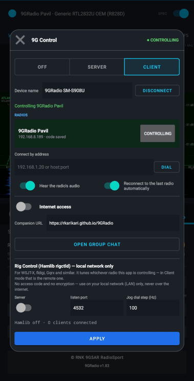
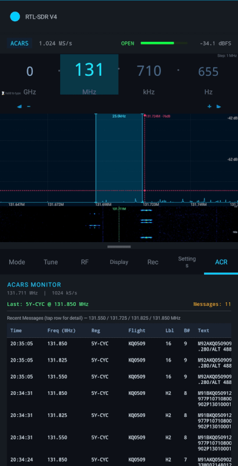

# 9GRadio — Full-Featured Android SDR App

A complete, production-quality Android SDR application written in Kotlin. Built and tuned around  
the **RTL-SDR V4** dongle family (RTL2832U + R828D or R828S, 28.8 MHz TCXO) — both the original  
**V4** (R828D) and the **V4L / "V4 Lite"** (R828S) — 9GRadio also fully supports the earlier  
**RTL-SDR V3** and other generic RTL2832U-based dongles (R820T/R820T2, E4000, FC0012/FC0013,  
FC2580), auto-identified the same way as the V4/V4L: no manual model selection needed.

**Package:** `com.radiosport.ninegradio`  
**Version:** 1.83

---

 | 

---

## Input & Output Modes

At its core, 9GRadio pulls in an IQ signal from one of three **input** sources, then does one or
more of four things with it as **output** — these can be mixed and combined (e.g. listen on the
internal decoder, feed an external decoder, and record to an IQ file, all from the same live USB
source, at the same time).

**Input — where the IQ signal comes from** (set via the **Source** dropdown in **Device Info**):

| # | Mode | Details |
|---|---|---|
| 1 | **USB** | A local RTL-SDR V4/V4L or generic RTL-compatible dongle connected directly via a USB OTG cable |
| 2 | **TCP** | A network IQ stream speaking the `rtl_tcp` wire protocol — either an on-device **Android RTL driver app** (reached over loopback) or a remote **`rtl_tcp` server** elsewhere on the network (see [rtl_tcp Server Source](#rtl_tcp-server-source)) |
| 3 | **File** | Playback of a previously recorded IQ file (`.iq`, `.iq.gz`, `.cf32`) through the exact same DSP pipeline as a live source — pick, play, pause/seek, and loop it like a recording |

**Output — what happens to the signal once it's tuned/demodulated:**

| # | Mode | Details |
|---|---|---|
| 1 | **Internal decoder** | 9GRadio's own built-in demodulation (AM/FM/NFM/WFM/SSB/CW/RAW IQ/APRS) and digital voice decoding (DMR, D-STAR, YSF, dPMR, NXDN, P25 Phase 1) |
| 2 | **External decoder** | The same pre-vocoder discriminator audio streamed live over TCP to a desktop tool (DSD-FME, dsd-neo, SDRTrunk, etc.) — runs *simultaneously* with the internal decoder, not instead of it (see [External Decoder Support](#external-decoder-support-simultaneous-decoding)) |
| 3 | **IQ file** | Raw IQ samples recorded straight to disk — `.iq` (uint8), `.iq.gz` (gzip-compressed), or `.cf32` (float32) — for offline analysis or replay via the File input above |
| 4 | **WAV file** | Demodulated audio recorded to disk as 16-bit PCM WAV (see [Recording](#recording)) |

---

## Features

### RF / Hardware Control
| Feature | Details |
|---|---|
| **Frequency range** | 500 kHz – 1766 MHz (full V4/V4L tuner range) |
| **Hardware support** | RTL-SDR Blog V4 (R828D) and V4L "Lite" (R828S), plus RTL-SDR V3 and generic RTL2832U dongles (R820T/R820T2, E4000, FC0012/FC0013, FC2580) — auto-identified from EEPROM/tuner probing, no manual model selection needed |
| **HF direct sampling** | I-branch or Q-branch (Q recommended on V4/V4L, though HF upconversion means you'll rarely need it) |
| **Auto HF switching** | Enables Q-branch automatically below 28.8 MHz |
| **Bias tee** | One-tap ~4.5 V on antenna port for powered LNAs/filters |
| **PPM correction** | ±50 ppm software compensation (TCXO ≈ 0). The **Fine** toggle beside the slider switches it to 0.1 ppm steps (within ±5 ppm of the current value); 0.1 ppm is 43 Hz at 433.9 MHz, so it matters mainly above ~100 MHz. Over rtl_tcp the fraction is applied as a small tune offset. **Kal** (Settings tab) measures the correction for you against GSM base stations and fills it in everywhere — see [PPM Calibration (Kal)](#ppm-calibration-kal) |
| **Gain control** | 29-step manual gain table + hardware AGC |
| **Sample rates** | 27 presets from 240 kS/s to 2.5 MS/s (low-rate narrow-mode band + main full-spectrum band) |
| **USB hot-plug** | Auto-detect and auto-launch on dongle insert |
| **rtl_tcp client** | Connect to a remote `rtl_tcp` / `rtl_tcp_andro` server over the network instead of a local USB dongle (see [rtl_tcp Server Source](#rtl_tcp-server-source) below) |

### Demodulation Modes
`AM` · `FM` · `NFM` · `WFM` · `WFM Stereo` · `USB` · `LSB` · `CW` · `CWR` · `DSB` · `RAW IQ`  
`APRS` · `SSTV` · `LRPT`

**Digital voice** (12.5 kHz NFM channel, shared discriminator pipeline):  
`DMR` · `D-STAR` · `YSF` · `dPMR` · `NXDN` · `P25 Phase 1` — all fully auto-detected and
voice-decoded via `Dig` (auto-detect — tries all known sync words and reports back whichever
protocol locks); `DMR`, `D-STAR`, and `YSF` additionally have their own dedicated tabs

Each digital voice tab shows a **Recent Calls** list rather than a raw frame log: consecutive
frames from the same transmission (same source/destination/talkgroup) are grouped into a single,
single-line row that updates in place — showing start time, call duration, frame type, IDs,
talker alias, encryption/emergency flags, and total frame count — instead of one row per frame.
A new row only appears when a genuinely new call starts (different talker/destination, or the
same one keying up again after the previous transmission has clearly ended).

### External Decoder Support (Simultaneous Decoding)
9GRadio can act as an RTL-SDR front end for a full desktop decoder — DSD-FME, dsd-neo,
SDRTrunk, or anything else that connects in over TCP for raw audio — **at the same time as**
its own built-in decoder, not instead of it. Every discriminator-audio block is fed to the
built-in `Dig`/DMR/D-STAR/YSF decoder and streamed out to the external TCP client in the same
pass; nothing about the local decode path is paused, gated, or slowed down by an external
client being connected (or not).

- **In Settings → External Decoder**: enable **"Serve Audio to External Decoder"**, then point a
  desktop decoder at this device's IP and the listen port shown (default `7355`, DSD-FME's own
  default TCP audio port) — e.g. `dsd-fme -fs -i tcp:<this device's IP>:<port>`.
- Streams the **same raw, pre-vocoder discriminator audio** that feeds the built-in decoder, as
  headerless 16-bit PCM (48 kHz by default) — not a re-encoded or down-sampled copy.
- **Bind Address** defaults to `0.0.0.0` (reachable from any device on the same network or USB
  tether); set it to `127.0.0.1` to restrict the connection to a decoder running on the same
  device.
- Useful for **cross-checking** the built-in decoder against a desktop reference implementation,
  and for **protocols 9GRadio doesn't decode natively** (P25 Phase 2, EDACS, ProVoice, encrypted
  traffic key handling, trunking control-channel following, etc.) — the desktop tool handles
  those while 9GRadio continues doing everything it already does with the same signal.
- If no external client is connected, the built-in decoder is completely unaffected — the stream
  is a no-op until something connects, and never blocks or slows the local audio/decode path
  while waiting.

### Memory Slots
Every demodulation mode gets **9 memory slots** to save frequencies and settings into, so you
can jump between favorite stations on the same mode without retyping the frequency or re-doing
your gain/filter setup each time.

- Tap the **[ Slot # ]** button on the Mode tab to save what you're currently listening to and
  move to the next slot — frequency, gain, filters, display settings, everything, all saved
  together as one snapshot.
- Each mode (AM, FM, USB, DMR, etc.) remembers its **own** set of 9 slots and its own **current**
  slot, so switching from FM to USB and back always returns you to where you left off on each.
- A little arrow button next to **[ Slot # ]** reverses the cycling direction (forward or
  backward through the slots), for quickly stepping back to a slot you just passed.
- A slot you've never used yet starts out matching Slot 0 (your mode's baseline setup), so it's
  never a jarring blank/wrong-frequency surprise the first time you land on it.
- **Nothing is ever lost**: 9GRadio automatically saves your current slot's settings the moment
  before it switches away, whether you're cycling slots, switching modes, or tuning to an EiBi
  station (see below) — you never need to manually "save" first.

### EiBi Shortwave Schedule
A built-in, searchable schedule of shortwave broadcast stations from around the world (sourced
from the well-known EiBi frequency list), right inside the app — no need to look anything up
separately.

- Open the **EiBi** tab to see the full station table: frequency, station name, language,
  target audience/region, broadcast times (UTC), and transmitter site.
- **Tap any row** to tune straight to that station — 9GRadio switches to the right mode and
  frequency for you automatically.
- **Sort** the list by frequency, station name, language, target area, time, or transmitter
  site, in either direction, using the sort chip above the table.
- **Filter** the list down to what you actually want to hear, using the filter button:
  - By **language** or **target area** (e.g. only English-language broadcasts, or only stations
    aimed at your part of the world)
  - By **mode** (AM, USB, LSB, CW, etc.)
  - **Broadcast stations only** — hides utility/ham-adjacent signals mixed into the same list
  - **Regular, dependable schedules only** — hides entries the schedule itself flags as
    irregular, tentative, or test transmissions
  - **On air right now** — only shows stations broadcasting at this exact moment (UTC)
  - **Hide likely-dead bands** — uses your phone's location and the current time to estimate
    which shortwave bands are realistically able to reach you right now (a real
    propagation-based estimate, similar in spirit to what shortwave listeners call "MUF/FOT"),
    and hides entries that are very unlikely to be audible so you're not wasting time on dead
    frequencies. This is a helpful estimate, not a guarantee — real band conditions can always
    differ.
- Your sort order and filter choices are **remembered** between app launches, so you don't have
  to set them up again every time.
- Tuning to an EiBi station uses its own dedicated memory slot, so it never overwrites any of
  your regular saved frequencies on the mode you were using.
- **Stays current on its own** — once the EiBi tab is open, the list keeps itself up to date
  automatically:
  - Filters that depend on the clock ("On air right now", "Hide likely-dead bands") are
    re-checked every minute, so stations quietly appear and disappear on their own as their
    broadcast windows open/close and as propagation conditions change — no need to close and
    reopen the tab or tap anything to see the current picture.
  - The underlying schedule data itself is checked periodically and re-downloaded in the
    background whenever it's gone stale (older than a week, or a new EiBi broadcast season has
    started), so the list of stations stays fresh without ever needing to remember to hit
    UPDATE. The **UPDATE** button is still there if you want to force a fresh download right
    away.

### Aircraft, Marine & Datalink Tracking
| Mode | Details |
|---|---|
| **ADS-B** | 1090 MHz Mode S decoding via a vendored, unmodified `readsb` — live aircraft list, radar-scope view, and full map view with callsign, altitude, speed, and position |
| **AIS** | 161.975/162.025 MHz marine VHF (both channels captured in one 300 kHz-wide tune), decoded via vendored AIS-catcher — live vessel map with MMSI, ship name, course, and speed |
| **ACARS** | 8 preset VHF channels (129–131 MHz band), up to 4 monitored simultaneously — live message log with registration/flight/label filtering and per-channel stats |
| **RDS** | Program Identification (PI), Program Service name, and RadioText decoded from any WFM broadcast station via vendored `redsea`, shown as a live overlay on the spectrum display |

### Image Decode Modes — SSTV & LRPT
Two dedicated demodulation modes, selectable directly from the **Mode** tab's Analogue (`SSTV`)
and Digital (`LRPT`) protocol chips, each opening its own hidden-until-active Drawer tab with a
live-updating image view plus **Save**/**Share** buttons for the decoded picture.

| Mode | Details |
|---|---|
| **SSTV** | Slow-Scan TV image decode (Robot 36, PD120, Scottie, Martin, etc. — auto-detected from the sync pulse) off ordinary FM-discriminator audio, same signal path as NFM. Free-tune: works at **any** frequency in the receiver's range, not just the ISS SSTV downlink — usable for the ISS, HF amateur SSTV nets (14.230/7.171 MHz USB, etc.), or any other SSTV source |
| **LRPT** | Meteor-M2 weather-satellite LRPT image decode (72 kBd QPSK, Viterbi + Reed-Solomon FEC) tapping raw wideband IQ directly, independent of the narrow demod chain. Free-tune: works at **any** frequency, not just the 137–138 MHz weather-satellite band — useful for other LRPT-alike QPSK downlinks, recorded/off-band IQ captures, or manual band-scanning |

Both modes get the full per-mode treatment every other demodulator gets: their own frequency,
gain, bandwidth, and every other RF/Display setting are saved and restored independently across
9 memory slots, exactly like AM/NFM/USB/etc. (see [Memory Slots](#memory-slots)).

The same two decoders are *also* auto-triggered by the [Sat tab](#satellite-tracking-sat-tab)
whenever it tracks a pass landing in the LRPT band or on the ISS SSTV frequency — selecting the
`SSTV`/`LRPT` chip from the Mode tab is an independent, always-available path to the identical
decoder and tab, not a replacement for that satellite-triggered convenience.

### Satellite Tracking (Sat tab)
Live pass prediction, one-tap tuning, and continuous real-time Doppler correction for amateur
radio satellites — turns the phone into a satellite ground station without any manual frequency
math.

- **Two independent, live-downloaded feeds**, never hardcoded: transponder frequencies/modes from
  [SatNOGS DB](https://db.satnogs.org) (the Libre Space Foundation's open, crowd-sourced
  transponder database), and orbital elements (TLEs) from Celestrak's amateur-satellite group —
  the same TLE source used by the reference desktop satellite-tracking applications this feature
  is modeled on. Both refresh automatically in the background (TLEs every 6 hours — orbital
  elements go stale much faster than transponder assignments — transponders on a longer cycle),
  plus a manual **UPDATE** chip to force both right away.
- **Pass list**, tap-to-tune: every upcoming pass for every satellite with a usable downlink,
  sorted by rise time, each row showing satellite name, AOS/LOS time, max elevation, and duration.
  **Tap any pass** to tune straight to that satellite's downlink and start tracking — no need to
  look up a frequency or do any math yourself.
- **Prediction window** (⏱ chip): cycles 6H / 12H / 24H / 48H of how far ahead to predict passes.
- **Minimum elevation** (▲ chip): cycles 0° / 10° / 20° / 30° — filters out grazing, low-elevation
  passes that are unlikely to be workable, the same "minimum elevation for a workable pass"
  convention used by dedicated satellite-tracking software.
- **Above Horizon Now** toggle: narrows the list to only satellites currently above your minimum
  elevation, for a quick "what can I work right this second" view instead of the full predicted
  window.
- **Live Doppler correction**: once tuned, the radio's actual RF frequency is continuously
  recalculated (roughly once per second) from the satellite's real-time range rate relative to
  your phone's GPS position, using the same relativistic Doppler formula real satellite-tracking
  ground stations use — so the signal stays centered in the passband throughout the whole pass
  without any manual re-tuning as the satellite rises, passes overhead, and sets. The main
  frequency dial, spectrum/waterfall display, and passband highlight all update live, right along
  with the correction, so what you see always matches what's actually tuned.
- **Live status readout**: elevation, azimuth, range, and the current Doppler offset being applied
  are shown for whichever satellite is actively tracked, refreshed by the same live loop that
  re-tunes the radio.
- **Transponder cycling** (⇅ TRANSPONDER chip, shown only when relevant): for satellites with more
  than one usable downlink (e.g. multiple FM channels, or an SSB/CW linear transponder with more
  than one workable spot inside it), cycle between them without leaving the tracked pass or losing
  Doppler tracking.
- **Own memory slot**: tuning from the Sat tab always uses a dedicated slot (separate from your
  9 regular per-mode slots and from the EiBi tab's own slot), so tracking a satellite never
  overwrites any of your other saved frequencies, and your regular slots are exactly as you left
  them when you come back to them afterward.
- **Stops itself automatically** at the end of a pass (LOS) — no need to remember to turn tracking
  off; the radio simply stays parked at the last frequency, the same way any other memory slot
  behaves once you're not actively driving it.
- Uses your phone's GPS position automatically for pass prediction and Doppler correction —
  nothing to enter manually, and moving to a new location is picked up on its own.
- **Weather-satellite (LRPT) and ISS SSTV passes** automatically pop open a dedicated image-decode
  tab while tracked — see [Image Decode Modes — SSTV & LRPT](#image-decode-modes--sstv--lrpt) for
  details, including the free-tune `SSTV`/`LRPT` Mode-tab chips that reach the same decoders on
  any frequency, independent of a live pass.

### Multilateration (MLAT)
A full multilateration stack for locating transmitters that don't self-report a position —
turns 2+ networked 9GRadio receivers (or any receiver speaking the same wire protocol) into a
station network that solves for a transmitter's position from time-difference-of-arrival (TDOA)
across stations, the same principle real-world ADS-B MLAT networks use.

- **Protocol-agnostic**: ADS-B, AIS, ACARS, RDS, and digital voice (DMR/D-STAR/YSF/dPMR/
  NXDN) can all be located this way — each protocol's decoded identity (ICAO, MMSI, RDS PI code,
  radio ID) is what lets multiple stations recognize they've heard the *same* transmission and
  contribute it to the same fix, no manual coordination required. Analog voice/AM/FM (no
  decodable identity) is also supported on a best-effort basis, keyed by carrier-onset timing on
  a shared tuned frequency. Paging (FLEX) is intentionally excluded — pagers are fixed
  infrastructure, so locating them adds nothing.
- **Own GPS position** pulled automatically from the device's location provider — nothing to
  enter manually, and a moved/newly-set-up receiver never contributes a stale position by
  accident.
- **Run your own station**, **join a station network** (this device's observations flow to an
  aggregation server — a remote one, or another 9GRadio phone acting as one), and/or **run the
  aggregation server yourself** for other receivers to join, all independently toggleable.
- **Contribute to a real public MLAT network** (ADSBExchange, adsb.lol, or a private
  `mlat-server`) using the genuine upstream wire protocol, entirely separate from this app's own
  station-network mode — run either, both, or neither.
- **Live MLAT Dashboard**: GPS fix quality, client/server link status, station/peer counts,
  fixes solved per second, sent/received observation counts, and a rolling **network self-test**
  that solves a synthetic moving target every cycle to continuously verify the whole pipeline
  — station timing, geometry, and solver — end to end, without needing a real transmission in
  the air to test against.
- **Station roster + map**: every contributing station plotted on a live map, including
  synthesized "virtual" stations (shown distinctly) that fill in for a missing 3rd/4th station
  when only 2 real receivers are connected, so the self-test and accuracy estimate still run.
- **Geometry-aware accuracy estimate**: a live GDOP-based estimate of achievable fix accuracy at
  your stations' actual current spacing, alongside what it would be at an ideal reference
  spacing — makes it immediately clear whether your receivers are placed usefully far apart.

### Channel Monitor
Simultaneous, wideband monitoring of an entire channelized band — PMR446, CB (27 MHz),
FRS/GMRS, MURS, or any other channel-grid band preset — instead of sequentially retuning
through each channel one at a time (scan → listen → retune → listen…).

- Open the **Tune tab** and tap one of the **📻 <band>** chips (alongside the regular
  band-preset chips) to open the Monitor tab and start monitoring.
- Channels are grouped into the fewest possible *clusters* that fit inside one FFT capture —
  most curated bands (PMR446, CB, MURS, FRS/GMRS) fit in a single cluster — so the hardware is
  tuned **once** for the whole band instead of once per channel, and every channel in the
  currently-watched cluster is read out of the same live FFT capture simultaneously.
- A channel only flags **active** after several consecutive captures clear an adaptive,
  noise-floor-derived threshold by a firm, explicit margin (shown live as
  *"Adaptive threshold: noise floor + margin"*), so brief noise spikes and birdies don't cause
  false triggers.
- Once confirmed active, the receiver retunes precisely onto that channel for clean on-frequency
  audio and dwells there — through a short hang timer after it goes quiet — before returning to
  cluster-wide monitoring. The spectrum/waterfall display stays live throughout, so every retune
  shows up as real activity rather than being hidden behind a dialog.
- The **channel table** shows each channel's last-heard time, peak signal level, and total
  confirmed-activation count, and lets you **lock out** a persistently noisy or birdie-prone
  channel (tap its lock glyph) so it's never flagged active.
- The **Recent Activity** log lists completed calls (time, channel, peak level, duration) once
  they've actually ended — tap any row there, or in the channel table, to tune straight to that
  frequency.

### Direction Finding (RDF)
A directional-antenna compass-ranging tab (in the same tabbed Drawer as ADS-B/AIS/ACARS/APRS)
for estimating the position of a transmitter that has **no self-reported position at all** —
the case MLAT's decoded-identity correlation can't help with on its own, but that a live bearing
can. RDF and MLAT are complementary halves of the same location-fusion pipeline, not separate
features: both feed the same solver, and the app always shows whichever currently produces the
better fix.

- **Live compass + signal-strength dial**: as you sweep, the phone/tablet's compass heading is
  paired with the live signal reading on the currently ranged target and plotted around a
  360° ring — a heat-mapped arc shows signal strength by direction, and a peak-direction chevron
  plants itself once a heading has enough corroborating samples to be trusted, rather than
  jumping to the single loudest (and possibly multipath-corrupted) reading.
- **Same compass as 9GNetDiag**: the dial is a flat compass card with 5° ticks, 30° numerals and
  a red N, **turning under a fixed marker at the top** so the way you are facing is always read
  straight ahead. The bearing needle, heat ring and peak chevron all turn with it — turn until
  the needle (or the hot part of the ring) is under the marker and you are pointing at the
  target. The marker goes **green when the needle is within 5° of dead ahead**. **Tap the dial**
  to switch to north-up (the marker then swings round the rim instead); the choice is remembered.
- **Compass health at a glance**: *Field* (µT), *Pitch* and *Roll* chips, whether the heading is
  *True* or *Magnetic* north (true needs a location; the last-known one is used if MLAT has no
  fix), and the sensor *Accuracy*. If accuracy is low the heading turns amber and the dial says
  **"Low accuracy — wave the phone in a figure-8"**; a field outside 20–70 µT warns about nearby
  metal or magnets. Heading is read from the top edge of the screen when the phone is flat, and
  from the back of the phone when it is held upright (tilted past 55°); it is also correct in
  landscape.
- **Works with MLAT switched off**: the RDF tab now runs the compass itself while it is in
  front, rather than relying on an MLAT role being enabled.
- **Requires a directional antenna, rigidly mounted to the device**: this is a hardware
  prerequisite, not a setting — RDF works by correlating signal strength against the device's
  live compass heading at each instant, so an omnidirectional antenna has no bearing to find, and
  an antenna that isn't fixed in the same orientation as the device (loose mount, hand-held with
  slipping grip) produces a confident-looking but silently wrong reading with no way for the app
  to detect the mismatch.
- **Target picker** covers any actively-heard station lacking a position fix — ADS-B/AIS/ACARS/
  digital-voice targets with `no pos`, other linked MLAT-wire stations, or the currently tuned RF
  frequency directly via a **"Track current tuner frequency"** toggle.
- **Trilaterates with linked stations**, not just a single bearing: one receiver alone can only
  produce a bearing ray; every additional linked MLAT peer also ranging on the same target lets
  the app solve a real geometric fix instead, the same way additional MLAT stations improve a
  TDOA solve.
- **Shares the location-fusion ladder with MLAT and RSSI fingerprinting**: a genuine MLAT
  time-difference-of-arrival solve always outranks an RDF or fingerprint-derived fix when one
  exists; a multi-station RDF trilateration outranks a single-station bearing ray or a
  fingerprint-only estimate. The dashboard shows the source and confidence of whichever fix is
  currently best, and upgrades to a better one immediately, without downgrading from a good fix
  the moment one update is briefly missed.

### PPM Calibration (Kal)
The **Kal** button on the Settings tab (it replaced the old RDF button — RDF is unchanged and is still
its own drawer tab) measures your dongle's crystal error against live GSM base stations, tells you how far
to trust the number, and writes it into **every PPM setting**. The measurement is
[`kalibrate-rtl`](https://github.com/steve-m/kalibrate-rtl) (BSD-2-Clause), vendored in
`app/src/main/cpp/kalibrate/` and driven from Kotlin, so it works on the IQ stream the app already has —
the dongle is never opened twice and nothing external is needed. The statistics, advice, history and charts
come from the user's standalone **9G kal v0.02**.

Kal opens as a full-height screen with a band selector (**GSM900**, **EGSM900**, **GSM850**, **GSM-R**) and
four tabs. DCS-1800 / PCS-1900 are not offered: they lie above the ~1766 MHz limit of RTL-SDR tuners.

- **Calibrate tab** — **Smart calibration** scans the band, picks the strongest GSM channels, measures
  each one (100 bursts by default) and pools them. If nothing is found at the radio's current PPM it
  retries at ±50 ppm (a very-far-off dongle), re-measures *around* the scan estimate, and measures an
  extra channel or two when the channels disagree. **Single channel** measures one ARFCN you pick.
  Options: gain override (the previous gain is restored), bursts per channel (30–300), channels to combine
  (1–5), the ±50 ppm search.
- **Result** — a big ppm figure with its **95 % confidence interval** and a **quality grade (0–100)**:
  Student-t interval per channel, channels pooled with **DerSimonian-Laird random-effects** weighting
  (plus a 0.02 ppm systematic floor per channel) so one odd base station cannot dominate; Cochran's Q and
  I² say whether the channels agree. A statistics card, plain-language **advice** (weak signal, USB
  trouble, too few bursts, rounding loss for whole-ppm apps, "still warming up"…) and failure diagnosis
  complete it. **Share report** / **Copy** give a text report.
- **Charts** — *Channel agreement* (forest plot of every channel's estimate and interval against the
  pooled result), *Offset distribution* (histogram of the bursts with the rejected ones marked),
  *Convergence* (running mean with its narrowing 95 % band). They update live while measuring.
- **Scan tab** — a quick band survey: power of every channel with the detection threshold, the GSM
  channels found (tap one to select it) with offset, level and kept/rejected status, a rough band-wide
  estimate, and a one-tap **Calibrate channel**.
- **History tab** — every measurement is saved (up to 500). A trend chart with error bars shows the clock
  over time; when the recent calibrations of the same dongle slope, Kal says the crystal is **still
  warming up** (least-squares drift in ppm/h) or that it is stable. **Export CSV**, delete one entry or all.
- **Log tab** — what the workflow decided and measured (optionally every burst offset); copy or share it.
- **Outlier exclusion**: a median/MAD filter (from the 9G kal project) discards bad readings at three
  levels — false sync detections in the band scan, individual bursts, and whole channels (a base station
  with its own frequency error). A plain average would be dragged off by a single false detection.
- **PPM auto-population** (switch on the Calibrate tab, on by default): when the result is trustworthy it
  is applied to *all* of the app's PPM settings at once —
  - the live correction on the radio, the RF-tab slider and the Settings-screen slider (the **Fine** toggle
    switches itself on when the value has a fractional part, so the 0.1 ppm result is visible);
  - every saved per-mode / per-slot PPM, so switching mode or memory slot never brings a stale value back;
  - every stored memory channel, so recalling one doesn't either;
  - the Rig Control / 9G Control remote, when controlling another radio.
  The result card says exactly what was updated; a **Apply … ppm to all PPM settings** button applies it
  by hand (e.g. when auto-apply is off). A scan alone is only a rough estimate and is never applied.
- **When it will not auto-apply**: fewer than 30 usable bursts, a 95 % interval wider than ±0.3 ppm,
  channels that disagree by more than 0.5 ppm, a quality score below 50, or a result outside the slider's
  ±50 ppm. Nothing changes in that case until you press **Apply** (the reasons are listed).
- **While it runs**: audio is muted and the radio runs at 272 kS/s; sample rate, frequency, gain, PPM and
  volume are put back afterwards (also if you press Stop or close the screen). The Scanner must be
  stopped first. Kal uses the live radio, not a recorded IQ file.
- **Limits**: needs GSM coverage and an antenna that can hear it; the figure is the crystal error
  measured at ~950 MHz. Takes roughly one to two minutes for a smart calibration.

### DSP Engine
- **GNU Radio Android backend** ([gnuradio-android](https://github.com/bastibl/gnuradio-android)) — when the
  toolchain is present, all core DSP primitives are accelerated by **VOLK** (Vectorized Library for Kernels),
  which auto-dispatches to the fastest SIMD implementation (NEON, NEON FP16, SVE) at runtime.
  VOLK fixes the poor/no-audio problems that occurred at IQ sample rates whose ratio to the audio sink rate
  is not a simple integer.
- **High-quality polyphase FIR resampler** (windowed sinc, Blackman-Harris)
- **NEON-accelerated** uint8→float conversion, FM discriminator, AM envelope, FIR filter
- Pure-Kotlin fallback on x86 or if native library unavailable
- **FM de-emphasis** (75 µs NA / 50 µs EU)
- **WFM stereo pilot** decoder (19 kHz PLL → 38 kHz subcarrier)
- **RDS decoder** (vendored `redsea`, MIT): Program Identification, Program Service name,
  RadioText, and Programme Type decoded from any WFM broadcast station, shown live over the
  spectrum display
- **APRS** decoder: AX.25 frame sync, NRZI, bit-stuffing removal, position parsing; optional
  **dual-watch** mode (two simultaneous APRS channels) on device sample rates ≥ ~820 kS/s
- **DSD-Neo digital voice decoding** (vendored `mbelib-neo`, GPL-2.0): decodes DMR, D-STAR,
  YSF, **dPMR**, and **NXDN** voice frames from the NFM discriminator output; `Dig` mode
  auto-identifies the protocol from its sync word and decodes voice for all five
- **ADS-B decoding** (vendored, unmodified `readsb`, GPL-2.0): full Mode S/1090ES decode running
  as a native child process fed raw IQ over stdin, with hardware/GPS-referenced timestamps
  precise enough to drive multilateration directly
- **AIS decoding** (vendored `AIS-catcher`, GPL-3.0): dual-channel marine VHF Class A/B
  transponder decode
- **ACARS decoding** (vendored `acarsdec`, GPL-2.0): up to 4 VHF channels demodulated
  simultaneously
- Squelch gate with per-mode threshold
- Configurable audio volume (0–200%), selectable audio sink rate

### Noise Reduction
- **Noise blanker** and **noise reducer** (adaptive noise-floor calibration, re-calibrates on
  mode/bandwidth change)
- **Noise Reducer profiles** — six gain-shaping profiles tuned for different noise conditions,
  selectable from the Mode tab: **Standard** (balanced, general-purpose), **Light Touch**
  (gentle suppression for an already-quiet band), **Heavy Static** (aggressive multi-band
  subtraction for high broadband noise/QRN), **Tonal / CW** (protects narrowband tones/carriers
  while cutting hard between them), **Adaptive Burst** (fast-tracking floor for noise that
  changes over time — QSB, intermittent QRM), and **Severe QRM** (deep, surgical suppression for
  severe, near-saturating broadband interference like power-line or switching noise).
- **Auto mode** for the Noise Reducer continuously samples the channel's noise characteristics
  and switches to whichever profile best matches current conditions — a brief burst or a strong
  signal's onset can't itself trigger a switch, since it only actually changes profile once two
  consecutive evaluations agree on a different one than what's currently active. The **"NR
  Profile" label** always reflects whichever profile is actually active, including ones Auto
  mode selects on its own.

### Spectrum & Waterfall Display
- Real-time **FFT spectrum** with pinch-zoom, pan, click-to-tune; zoom/pan is mirrored live
  between the spectrum and waterfall views so both always show the same window
- **Waterfall** (scrolling spectrogram) — 10 color palettes: Rainbow, Heat, Grayscale, Blue-White,
  Purple-Yellow, Viridis, Inferno, Magma, Turbo, Solar
- **10 spectrum themes**: Classic, Futuristic, Amber, Grayscale, Purple, Solar, Neon, Ice,
  Midnight, Sakura
- **FFT sizes**: 256 – 8192 points
- **FFT decimation**: Off / ÷2 / ÷4 / ÷8 / ÷16 / ÷32 / ÷64, narrowing the analysis bandwidth for
  a sharper, lower-noise view of narrowband signals
- **Frame averaging**: Off / ×2 / ×4 / ×8 / ×16 / ×32 / ×64 (running N-frame linear-power average,
  reduces the displayed noise floor by up to ~15 dB; the trace updates every frame, so ×64 is as
  smooth to watch as ×8, just slower to follow signal changes)
- **Intelligent per-protocol auto-configuration**: the first time a mode is selected, FFT size
  (2048), frame averaging (×8), and a protocol-appropriate decimation factor are seeded
  automatically — e.g. CW/CWR ÷64, USB/LSB and NFM ÷32, AM and APRS ÷16, DMR/YSF/D-STAR ÷8,
  WFM left at full bandwidth. Any manual change you make for a mode is remembered per-mode from
  then on and is never overwritten by the auto-defaults again.
- **8 window functions**: Rectangular, Hann, Hamming, Blackman, Blackman-Harris, Flat Top, Kaiser
  (adjustable β), Nuttall
- Configurable smoothing (exponential moving average)
- **True-intelligence Auto dB Range**: analyses the live spectrum and sets the floor just above
  the noise (barely visible / near-black on the waterfall) and the ceiling so the strongest
  signal sits at ~70% of the display height; falls back to a fixed 20 dB window above the noise
  floor when no signal is present. Converges within 5 seconds of being enabled, then holds
  steady — it does not creep or hunt indefinitely — and only re-acquires if the signal picture
  changes significantly (e.g. after retuning)
- **Peak hold** trace with configurable decay rate
- **Estimated noise-floor line** (15th-percentile of the visible spectrum), shown as a dashed
  overlay
- **Peak annotations**: top-3 local spectral maxima auto-labelled with frequency and dBFS
- **Live crosshair**: shows exact frequency + dBFS under a finger while touching the display
- **Long-press reference marker**: locks a persistent frequency/level marker for comparison
- Frequency axis with zoom-aware labels; minor grid lines at 5 dB steps
- **Squelch threshold line** with dashed overlay
- **Demodulated channel bandwidth highlight**, correctly anchored to the dial frequency for USB/LSB
- **Bookmark markers** pinned on spectrum
- Double-tap to reset zoom

### Frequency Display & Input
- Large 4-group LCD-style readout (GHz · MHz · kHz · Hz)
- Tap group to select step size; scroll to tune
- Up/down step buttons
- Fling gesture for rapid tuning
- Mode-aware recommended tuning step

### S-Meter
- Logarithmic segment bar (S1–S9 + S9+10 to S9+60)
- Peak hold with slow decay
- Colour-coded zones: green / yellow / red
- Live dBFS numeric readout

### Memory Channels
- Unlimited channels in named groups
- Stores: frequency, mode, sample rate, gain, squelch, bias-tee, direct sampling, PPM, notes
- Swipe-to-delete, tap-to-tune, long-press to edit
- JSON export / import

### Frequency Database (built-in)
50+ pre-loaded entries across: FM Broadcast · Aviation · Weather · Ham Radio · Marine ·  
ISM/IoT · Shortwave · HF Beacons · Satellite · Paging · APRS

### Bookmarks
- Add, label, and colour-code frequency bookmarks
- Shown as marker lines on spectrum

### Frequency Scanner
- Continuous range scan with configurable step, squelch, dwell time
- Memory scan (list of specific frequencies)
- Pause / resume / direction reversal
- Hit log (tap entry to tune)
- Real-time progress bar and signal readout

### Protocol Activities
- **APRS Activity**: live station list, packet log, map-style position tracking

### Per-Mode Settings Memory
Every demodulation mode remembers its own complete RF and display configuration — frequency,
gain, AGC state, sample rate, FFT size/decimation/frame averaging, dB range, squelch, IF
bandwidth, spectrum theme, waterfall palette, and more — and restores it automatically the next
time that mode is selected, so switching between e.g. NFM and USB never requires re-tuning your
display or RF settings from scratch. This includes the PPM correction (to 0.1 ppm); **Kal** updates it in every mode and slot at once.

### Recording
- **IQ recording**: raw uint8 (`.iq`), GZip-compressed (`.iq.gz`), float32 (`.cf32`)
- **Audio recording**: WAV, 16-bit PCM
- Recordings browser with playback (WAV) and share
- Recording metadata stored in Room database
- Auto-stop on size limit with optional 2 GB splitting

### Settings
- Full PreferenceScreen with 75+ configurable options across RF, display, and recording categories
- Export / import settings as JSON
- Per-feature category organisation
- The drawer's **Settings tab** also holds the quick buttons **Scanner**, **MLAT** and **Kal** (PPM calibration — see [PPM Calibration (Kal)](#ppm-calibration-kal))

### Update Notifications
- **Check for new version** (Settings → Misc, on by default) looks at this repository's **Latest** GitHub release
  (`/releases/latest`) and, if it is newer than the installed build, shows a small translucent pop-up under the tool bar.
  Tap it to download and install the release APK (or to open the release page when it has none); swipe it away in either
  direction to dismiss it — it is not shown again for that release, only for a newer one.
- While the update downloads, the pop-up shows a **progress bar** with the live percentage where the UPDATE button was.
  The bar animates until the first figure arrives (or if the size is unknown) and dims with "Waiting for network…"
  while the system holds the download (no connection, waiting for Wi-Fi). The figures are read from the system
  DownloadManager on a background-priority thread, only while the app is on screen; screen readers hear 25 % milestones
  rather than every change. Android's own download notification still appears as well.
- Stays out of the radio's way: it only looks while the app is open on screen (no background job, alarm or service), about
  45 s after start-up and at most once a day, with one small request on its own lowest-priority thread; a failed look is
  retried after an hour. It stands down only with no connection, or on a metered connection under Data Saver, and tries
  again at the next launch; **Battery Saver does not stop it** (one small request a day, made only while the app is open).
  Switch it off in Settings and nothing is ever requested.
- The version is read from the release tag (`9GRadio_v1.77`), else its title, else the APK file name, so any tag style
  works. If GitHub's API refuses (its anonymous limit is per IP address) the `releases/latest` redirect is used instead.
- The APK is only ever fetched from this repository's release downloads, downloaded by Android's DownloadManager, and
  checked (size, that it is 9GRadio, that its versionCode is higher) before the system installer is opened; Android still
  requires it to carry the same signing key. The first time, Android asks you to allow 9GRadio to install apps.

### Diagnostics
- **Debug Panel**: live per-stage health monitor for the full RTL-SDR → DSP → Audio/Waterfall/
  Spectrum pipeline, plus live DSP metrics and audio routing status
- **Native (C++) vs Kotlin visibility**: the Debug Panel reports, per JNI library, whether it is
  loaded and running right now, and for every accelerated DSP kernel whether the C++ or the Kotlin
  fallback implementation is actually executing (call counts and average time)
- **Noise Reduction Performance tile**: live per-frame cost of the STFT noise reducer, real-time
  budget/headroom and CPU share, worst-case frame time, and an on-demand C++ vs Kotlin benchmark
- **Update Check tile**: a brief report on the last "Check for new version" look: when it ran (also if it was skipped
  or failed), what it meant for this build, where the answer came from (GitHub API, an unchanged `304`, or the
  `releases/latest` redirect fallback) with its HTTP status and duration, installed vs latest known version, whether
  the pop-up is showing or was swiped away, and when the next look is due. Read-only: opening the page never causes a request
- **RTL-SDR Test Activity**: standalone USB/tuner connectivity and register-level test screen

### Background Operation
- **Foreground service** keeps SDR running with screen off
- Wake-lock option for unattended recording
- Persistent notification with quick Disconnect action
- Survives activity lifecycle changes via service binding

### rtl_tcp Server Source
9GRadio can pull its IQ stream from any `rtl_tcp`-compatible server over the network — a
Raspberry Pi or other Linux box running stock `rtl_tcp`, another Android device running
`rtl_tcp_andro`, or an on-device driver app reached over loopback — instead of a
locally attached USB dongle. This uses the standard `rtl_tcp` wire protocol (the `RTL0` magic
handshake followed by 5-byte tuning/gain commands and a raw unsigned-8 interleaved IQ stream),
so it works with any server implementing that protocol, not just RTL-SDR Blog's own tools.

**Connecting:**
1. Open **Device Info** (tap the device/antenna icon) and set the **Source** dropdown to
   **External RTL-SDR Server**.
2. Either tap **🔍 Scan** to find servers automatically on the local network — this runs mDNS
   discovery, a UDP broadcast probe, and a TCP handshake check in parallel, and lists any
   confirmed `rtl_tcp` servers found — or enter the **host and port** manually if you already
   know them. The rtl_tcp default port is `1234`; `1235`, `2000`, and `4711` are also probed
   automatically during a scan since some wrapper scripts/Docker images use them.
3. Tap **🌐 Connect**.

**Testing a connection (before or after connecting):**
- Tap **🧪 Test** to open a short-lived probe connection to the entered host:port, measure its
  actual sustained throughput over ~4 seconds, and tear the probe down again — this never
  touches the live decode chain or changes the server's sample rate, so it's safe to run before
  committing to a connection.
- The result is shown against the throughput actually needed for the sample rate currently
  selected, with a verdict of **✅ Comfortable**, **⚠️ Marginal**, or **❌ Insufficient** — useful
  for sanity-checking a WiFi link or a remote server's uplink before relying on it.
- Once actually connected via **🌐 Connect**, the same throughput readout switches to a live,
  continuously-updating measurement instead of a one-off test.

### 9G Control — controlling one 9GRadio from another
9GRadio can be fully remote controlled by another 9GRadio device. Put the RTL-SDR on one phone or tablet, leave it
somewhere with a good antenna, and operate it from a second device — in the next room, across town or on the other
side of the world — as if the radio were in your hand. (In the app, find it under **Settings → 9G Control**.)

**The two roles**
- **Server** — set 9G Control to **Server** on the device that is connected to the RTL-SDR. This is the radio. It does
  the receiving and decoding, and shares everything with the devices that control it.
- **Client** — set 9G Control to **Client** on the device that will act as the remote / controller. It shows you the
  radio's screen and sends your commands to it.
- **Off** — 9G Control does nothing. The device is not visible to others and there is no chat.

**Getting started**
1. On the radio device, open **Settings → 9G Control** and choose **Server**. The app creates an **access code** —
   tap **Show** to read it. Anyone who has this code can control your radio, so treat it like a password.
2. On the controller, choose **Client**. Radios on the same Wi-Fi appear in the list within a few seconds.
3. Tap **Connect** and type in the access code. The controller can remember it, so you only enter it once.
4. That's it. Tuning, mode, gain and every other normal control now work on the remote radio. Tap **Disconnect**
   at any time to get your own receiver back exactly as you left it.

**What you can do from the controller**
- Tune the radio, change mode and bandwidth, adjust gain and AGC, noise reduction and filters, squelch and other
  receiver settings — every ordinary control in the app drives the remote radio.
- Start and stop the radio's audio and recordings.
- Use the specialist screens on the remote radio: the Channel Monitor, the APRS and ACARS monitors, satellite
  tracking and the decoder tabs.

**What comes back to you**
- The radio's live **spectrum and waterfall**, signal meters and settings, exactly as the radio sees them.
- The radio's **sound**, playing on the controller.
- Everything the radio **decodes**: aircraft and ship positions, radio text, digital voice, APRS and ACARS messages
  and more, filled in on the controller's own tabs.
- **Satellite pictures** (SSTV and weather-satellite images) as the radio receives them. A controller that joins in the
  middle of a pass is caught up automatically.

**Several controllers at once**
One radio can be controlled by up to **4 devices at the same time**. Each one gets its own live spectrum, sound and
decoded data, and all of them can send commands, so agree who is doing what (the group chat is handy for that).
A fifth device is told the radio has too many controllers connected and can join as soon as one of the four
disconnects. The limit is deliberately cautious: the radio is a phone that is also busy receiving, and every
controller adds its own share of work and data traffic. A controller on a slow connection loses a little picture or
sound rather than slowing anyone else down.

**Near or far**
- **Same Wi-Fi** — nothing to set up. Radios find each other by themselves.
- **Other networks** — if you know where the radio is, you can connect to it directly, or share a **join link** from the
  radio (the access code is deliberately never inside the link).
- **Anywhere on the internet** — turn on **Internet access** on both devices. It is off by default, so everything stays
  on your own network unless you choose otherwise.

**Group chat**
While 9G Control is set to Server or Client, a chat button appears on the main screen, with a badge for unread
messages. Everyone connected can talk to each other — useful for sharing what you are hearing or for taking turns
at the controls. Chat history is kept between sessions. Chat messages are not private in the way a control session is,
so don't put anything confidential in them.

**Safe and private**
- 9G Control is built to be **secure over the internet** as well as on your own network (see the comparison below).
- A radio with no access code refuses everyone, so nobody can get in by accident.
- The access code is never sent over the air. The devices prove to each other that they know it, which also confirms
  you are talking to your own radio and not an impostor.
- Everything between the radio and its controllers is scrambled so nobody on the way can listen in or change
  anything — including over the internet.
- Repeated wrong codes slow a would-be intruder down more and more.
- If a code gets out, choose **Make a new code** on the radio: everyone connected is disconnected and needs the new one.

**Good to know**
- Keep 9GRadio running on the Server device. It keeps the receiver going in the background, but if the app is closed
  or the phone is switched off, the controllers lose the radio.
- Your controller's own memory channels, bookmarks and decoder windows stay on that device. Tuning to one simply sends
  that frequency to the radio.
- The frequency scanner runs only on the device it was started on; it isn't mirrored to controllers.
- On a remote radio, APRS watches one channel rather than both the North American and European channels at once.
- When you disconnect, the controller goes back to its own settings and its own receiver.

### 9G Control vs Rig Control (Hamlib rigctld)
9GRadio has two different ways to be controlled remotely. They are **not** equally safe, so it is worth knowing which is which.

| | **9G Control** | **Rig Control (Hamlib rigctld)** |
|---|---|---|
| What it is | One 9GRadio controls another 9GRadio | PC software (WSJT-X, JTDX, fldigi, Gqrx, SDR++, `rigctl`) tunes your 9GRadio |
| Access code | **Required** — a radio with no code refuses everyone | **None** — anyone who can reach it can use it |
| Encrypted | **Yes** — everything between the radio and its controllers is scrambled | **No** — plain, unprotected traffic |
| Safe over the internet | ✅ **Yes** — designed for it (turn on **Internet access**) | ❌ **No** — never expose it to the internet |
| Where to use it | Same Wi-Fi, or anywhere in the world | **Your own local network (LAN) only** |

- **9G Control is secure for use over the internet.** Only devices that know the access code can connect, and nobody on the
  way can listen in or change anything.
- **Rig Control (Hamlib rigctld) is for local network (LAN) use only.** It follows the standard Hamlib `rigctld` design, which has
  no login and no encryption, so run it only on a network you trust (for example your home Wi-Fi), and switch it
  off when you are not using it. Do not forward its port on your router or otherwise make it reachable from the internet.

### 9G Control — remote control of one 9GRadio by another (Off / Server / Client)
**Settings → 9G Control** has one master switch with three states:

| Mode | What this device does |
|---|---|
| **Off** | Nothing. Not on the network, no chat. |
| **Server** | This device holds the radio. Another 9GRadio can find it and — with its access code — **fully control it**: frequency, mode, sample rate, gain/AGC, bias-tee, noise blanker/reducer, IF bandwidth, direct sampling, PPM, squelch, FFT size/decimation, and starting/stopping audio and IQ recording on the radio. It also streams its **spectrum/waterfall, meters, demodulated audio and decoded data** (RDS, AIS, ADS-B, ACARS, APRS, DMR/P25/D-STAR/YSF/NXDN/M17…) to the controller. |
| **Client** | This device controls another 9GRadio. Pick a radio in the list and connect: from then on **every ordinary control in the app drives the remote radio**, the spectrum, waterfall, S-meter, settings and **decoder tables (AIS, ADS-B, DMR, RDS…)** shown are the remote radio's, and its audio plays here. Your own settings are put back when you disconnect. |

- **Finding each other (the mesh).** Radios and controllers form a peer-to-peer mesh ported from
  9GSound: UDP LAN beacons, a bounded parallel subnet sweep (which also works across VPN
  tunnels such as ZeroTier), manual **Connect by address**, and shareable `ninegradio://join` links
  (**Share join link** on a radio — the access code is deliberately *not* in the link). Radios on the same
  Wi-Fi appear in the Client's list within seconds with no setup.
- **Over the internet (optional).** Turn on **Internet access** and a Server
  opens a router port (UPnP / NAT-PMP / PCP), lists itself in a small live directory once a
  connect-back check has confirmed a 9GRadio answers, and — where the network can't accept inbound
  connections (carrier-grade NAT, mobile data) — is reached through a relay it dials *out* to. Clients
  see directory radios in the same list. Off by default.
- **Several controllers at once.** One radio can be controlled by up to **4 devices at the same time**, each with its
  own live spectrum, waterfall, audio and decoder data. A fifth device is told the radio has too many controllers
  connected and can join as soon as one of the four disconnects. The limit is deliberately cautious rather than a
  measured ceiling: the radio is a phone that is also running the receiver, and every controller adds its own
  encrypted stream, picture transfers and Wi-Fi or mobile-data traffic. The spectrum is prepared once and shared, and a
  controller on a slow connection simply loses some picture and sound instead of slowing the others.
- **Security.** A Server with no access code refuses everyone. The code is 12 random characters (60 bits),
  shown once in the app, stored Keystore-encrypted, and never sent: the controller proves it knows it with a
  salted PBKDF2 challenge/response that also proves the radio to the controller (no impostor radio), after
  which **every frame is AES-256-GCM encrypted and replay-protected** — so neither a relay
  nor anyone on the path can read or alter a session. Wrong codes are throttled per source (4 free
  tries, then 30 s doubling to 15 min). A controller saves a radio's code (encrypted) to reconnect by itself.
  *Make a new code* in the Server section cuts off everyone connected. Anyone who has the code controls the
  radio, so share it like a password.
- **Group chat.** Whenever 9G Control is Server or Client, a chat button appears on the main screen
  (with an unread badge) that opens the same conversation screen as 9GSound: grouped bubbles, day
  separators, long-press to copy or mute a person, rate limiting, history that survives restarts, and
  honest "nobody was linked" marking. Messages flood across the mesh (6 hops, de-duplicated) and are not
  end-to-end encrypted.
- **Limits worth knowing.** A radio serves up to 4 controllers at once; all may issue commands (use the chat
  to coordinate). A mode a controller picks is applied on the radio exactly as a tap on its own mode chips (an open EiBi/Sat tab closes, the protocol's tab opens, and the screen moves off a protocol tab that has just closed). Memory channels, bookmarks and decoder windows remain local to each device — tuning
  from them is sent to the radio like any other tune. Decoded protocol data is mirrored (the radio decodes,
  the controller's AIS/ADS-B/ACARS/APRS/RDS/digital-voice tabs show the results — sent in batches, and only
  while the matching mode is selected). The standalone **APRS Monitor** and **ACARS Monitor** screens work
  against a remote radio too: they tune it, show its signal state and list what it decodes (APRS is
  single-channel on a remote radio — the NA+EU dual-watch needs raw audio for two channels, which stays on
  the radio). **SSTV and LRPT satellite images** are decoded on the radio and rebuilt on the controller: the
  radio sends only the picture rows a controller does not have yet, compressed, so a controller that joins
  mid-pass is caught up and one that is current costs nothing; the SSTV/LRPT tabs appear on the controller
  when the radio is on a satellite frequency or in those modes. The **DMR slot buttons** (Auto / 1 / 2 /
  Stereo) set the radio's slot and show the radio's actual one. The **Channel Monitor** runs on the radio (it
  reads the radio's own FFT and retunes its dongle): a controller's band chips, Pause, Close, lockouts and
  sensitivity slider are commands to it, its Monitor tab opens on the radio's screen, and the radio's channel
  table, active channel and thresholds are mirrored live — the controller's dial and spectrum follow the radio
  onto each active channel, and a controller that joins a running monitor is shown it straight away. The frequency scanner still runs on the
  radio or the local receiver only and is not mirrored. The radio side must stay running: keep 9GRadio
  open (its foreground service keeps the receiver alive) on the Server device.

### Rig Control — Hamlib `rigctld`-compatible server (local network only)
> ⚠️ **Local network (LAN) use only.** Rig Control has no access code and no encryption. Unlike 9G Control, it is
> **not** secure for use over the internet — see [9G Control vs Rig Control](#9g-control-vs-rig-control-hamlib-rigctld).

Turns 9GRadio into a network-controllable receiver by running a small server that speaks the
same wire protocol as Hamlib's `rigctld` — the de-facto standard most amateur radio and SDR
software already uses to talk to a "rig." Any Hamlib-compatible program on a PC on the same
network (WSJT-X, JTDX, fldigi, Gqrx's remote-control panel, SDR++'s rig-control module, or the
plain `rigctl` command-line tool) can read and remotely set 9GRadio's frequency and demodulation
mode. Both the **"Gqrx"** rig type and the standard **"Hamlib NET rigctl / rigctld"** rig type
are supported.

- Since 9GRadio is built around a receive-only RTL-SDR dongle rather than a transceiver, Rig
  Control deliberately implements only the receive-relevant subset of the protocol —
  transmitter-only commands (PTT, split, TX power) are recognised so clients don't hang or
  error out, but are answered with Hamlib's own "not supported" result code.
- **In Settings → 9G Control → Rig Control (Hamlib rigctld)**: switch **Server** on, leave **Listen port** at its default
  `4532` (rigctld's own long-standing default) unless it's already in use, optionally set the
  **Jog dial step size (Hz)** for an external rotary encoder/jog-dial input, then tap **Apply**.
  The line under the switch reads **Hamlib listening on :4532**. Hamlib is independent of the
  Off/Server/Client switch and drives whichever receiver this app is controlling — in **Client**
  mode, WSJT-X or fldigi on a PC tunes the *remote* radio through this phone.
- A live **Connected clients** count (updated once per second) confirms when a PC client has
  actually connected.
- Supports both traditional single-letter Hamlib commands and their long-form `\command`
  aliases (`f`/`\get_freq`, `F <hz>`/`\set_freq`, `m`/`\get_mode`, `M <mode> <pb>`/`\set_mode`,
  `\dump_state`, `\chk_vfo`, plus `q`/`Q` to close the connection), matching upstream `rigctld`'s
  behavior for the subset it implements.
- 9GRadio's own demodulation modes are translated to the closest Hamlib mode token (e.g.
  AM→AM, FM/NFM→FM, WFM/WFM Stereo→WFM, USB→USB, LSB→LSB, CW→CW, CWR→CWR, DSB→AM, and digital
  voice modes → FM, reporting the underlying FM discriminator since Hamlib has no matching
  token for them).
- **Multiple simultaneous clients** are supported — e.g. a logging program and WSJT-X both
  watching the same VFO — and every connected client sees the same, single, authoritative
  frequency kept in sync in both directions.
- An external rotary controller (jog dial via USB-serial or HID) uses the exact same underlying
  frequency-setting call as a Rig Control client's `F`/`set_freq` command, so external jog input
  and a network client always agree on one authoritative VFO.
- The Hamlib port hands over frequency/mode only — it doesn't carry audio (the Server/Client mode above does). For a fully wireless
  setup, phone/tablet receive audio can be routed to a PC over Bluetooth (A2DP) into a virtual
  audio cable, which a program like WSJT-X or fldigi can then select as its microphone input;
  this runs entirely independently of the Rig Control TCP connection.
- **No pairing, login, or encryption on the Hamlib port** — like upstream `rigctld` itself, it is a plain
  unauthenticated TCP service (unlike the Server/Client control above, which is authenticated and encrypted). Only enable it on trusted networks, and turn **Server** off when
  not actively using it; because 9GRadio is receive-only, the worst case of an unwanted
  connection is someone else retuning your receiver.

---

<details>
<summary><h2 style="display:inline;">Architecture</h2></summary>

```
┌─────────────────────────────────────────────────────────┐
│  Activities / Fragments (UI layer)                       │
│  MainActivity · ScannerActivity · MemoryActivity        │
│  RecordingActivity · SettingsActivity · SpectrumActivity│
│  AprsActivity · AdsbActivity · AcarsActivity            │
│  MlatSettingsActivity · DebugPanelActivity              │
│  RtlSdrTestActivity                                       │
└──────────────────┬──────────────────────────────────────┘
                   │ bind
┌──────────────────▼──────────────────────────────────────┐
│  MainViewModel (single source of truth)                  │
│  StateFlow: freq · mode · gain · biastee · spectrum …   │
│  Per-mode settings snapshot store (save/restore)         │
└──────────────────┬──────────────────────────────────────┘
                   │ bind
┌──────────────────▼──────────────────────────────────────┐
│  RtlSdrService  (foreground, survives orientation)       │
│  ┌───────────────┐   ┌───────────────────────────────┐  │
│  │ RtlSdrDevice  │   │ DspEngine                     │  │
│  │  USB driver   │──▶│  FFT · Demodulator · Squelch  │  │
│  │  R828D/R828S  │   │  Resampler · AudioEngine      │  │
│  │  Bias-tee     │   │  IqRecorder · ProtocolDecoders│  │
│  │  Direct-samp  │   │  DigitalVoiceDecoder (mbelib) │  │
│  │               │   │  ReadsbProcess (ADS-B)        │  │
│  │               │   │  AisCatcherProcess (AIS)      │  │
│  │               │   │  AcarsMultiChannelDecoder     │  │
│  │               │   │  RdsDecoder (redsea)          │  │
│  └───────────────┘   └───────────────┬───────────────┘  │
└───────────────────────────────────────┼──────────────────┘
                                         │ submitDetection()
                        ┌────────────────▼────────────────┐
                        │  MlatManager                     │
                        │  MlatClient · MlatServer          │
                        │  UpstreamMlatClient · BeastReader │
                        └────────────────┬──────────────────┘
                                         │
┌──────────────────▼──────────────────────────────────────┐
│  Room Database                                           │
│  MemoryChannel · Bookmark · ScanEntry · Recording       │
└─────────────────────────────────────────────────────────┘
```

</details>

---

## Build Instructions

### Requirements
- Android Studio Hedgehog (2023.1.1) or newer
- Android SDK 34, NDK 25+
- Gradle 8.2+
- Physical Android device with **USB Host** support (API 26+)
- RTL-SDR V4 or V4L dongle + USB-C OTG adapter

### GNU Radio VOLK kernels

VOLK kernel implementations are vendored directly in
`app/src/main/cpp/include/volk_android.h`, extracted from the
[gnuradio-android](https://github.com/bastibl/gnuradio-android) toolchain (GPLv3).
No separate toolchain build is required — the kernels compile as part of the
normal Gradle build and activate NEON automatically on ARM devices.

### DSD-Neo / mbelib-neo

Digital voice decoding (DMR, D-STAR, YSF, dPMR, and NXDN — the latter two auto-detected
and decoded via the `Dig` mode) is powered by a vendored copy of `mbelib-neo`
(GPL-2.0-or-later) under `app/src/main/cpp/mbelib-neo/`, built as part of the normal NDK
build alongside the rest of `app/src/main/cpp/`.

### kalibrate (Kal: GSM-based PPM calibration)

The **Kal** button on the Settings tab (it replaced the RDF button; RDF is still its own drawer tab) opens a full-height,
four-tab screen (Calibrate / Scan / History / Log) that measures the dongle's crystal error against GSM base stations and
writes the result into every PPM setting. The DSP is [`kalibrate-rtl`](https://github.com/steve-m/kalibrate-rtl) (BSD-2-Clause),
vendored in `app/src/main/cpp/kalibrate/` (see `PATCHES.md` there for exactly what changed) and built as the JNI library
`ninegradio_kal`. The scan and measurement loops are Kotlin (`kal/KalCalibrator.kt`) fed from the IQ stream the app already has,
so the radio is never opened twice. The analysis layer (statistics, advisor, history, report, charts) is ported from the
standalone **9G kal v0.02** and is pure Kotlin where possible so it is unit-tested on the JVM.

* **Workflows** (`KalCalibrator`): `runScan` (power sweep + FCCH search + scan-level outlier rejection), `runChannel`
  (N bursts on one ARFCN, burst-level rejection, Student-t interval) and `runSmart` (scan with a +-50 ppm retry, re-centre on the scan
  estimate, measure the strongest channels — more if they disagree — then random-effects pooling). The engine may change the
  source's PPM temporarily; the original value is always restored.
* **Outlier exclusion** (median/MAD, from the 9G kal project, `robust.h`) at three levels: false sync detections in the band scan
  (e.g. a 31 kHz tone), individual bursts, and whole channels (a base station with its own error).
* **Analysis** (`kal/`): `Stats` (summary, t/chi-square critical values, regression, DerSimonian-Laird pooling, histogram, running mean),
  `Advisor` (quality score, advice, warm-up drift, failure diagnosis), `History` (TSV store, CSV export), `Report`, `Charts`
  (canvas charts, no chart library), `KalSession` (state that survives closing the screen), `KalScreens` / `KalSheet` (UI).
* **Bands**: GSM900, EGSM900, GSM850, GSM-R. DCS-1800 / PCS-1900 are above the RTL-SDR tuner range (~1766 MHz) and are not offered
  (an old saved DCS1800 setting falls back to GSM900).
* **Auto-populate** (switch, on by default): when the result is trustworthy (>= 30 usable bursts, 95 % interval <= 0.3 ppm,
  channels within 0.5 ppm, score >= 50, inside the slider's range) it is applied to the live correction, the RF-tab and Settings
  sliders (the Fine toggle is switched on for fractional values), every saved per-mode/per-slot PPM, and every stored memory channel.
  Otherwise nothing changes until **Apply** is pressed.
* The radio's sample rate, frequency, gain, PPM and volume are restored afterwards. Needs GSM coverage; it measures at ~950 MHz, so
  the result is the crystal error there; if your HF correction should differ, adjust it afterwards (the slider is unchanged).
* **Tests**: `KalMathTest`, `KalLogicTest` (JUnit); the engine is exercised end-to-end against a simulated GSM band by
  `app/src/main/cpp/tests/jvm/KalE2E.kt` (see `run_kal_e2e.sh` there) and the native part by `tests/kalibrate_host_test.cc`.

### readsb (ADS-B / Mode S)

ADS-B decoding is powered by a vendored, unmodified copy of
[`readsb`](https://github.com/rkarikari/readsb) (GPL-2.0-or-later) under
`app/src/main/cpp/readsb/`, built by `cpp/CMakeLists.txt` as a standalone
native executable (not a JNI library — readsb is an application with its own
main loop and network servers, so it is run as a child process rather than
called into). readsb is a maintained fork/successor of dump1090-fa /
dump1090-mutability and preserves the same `--ifile`/`--iformat UC8` stdin
input mode and Basestation ("SBS") network output this app relies on. The
app feeds it raw IQ samples over stdin in RTL-SDR's native UC8 format and
reads back decoded aircraft state over its SBS output; see
`app/src/main/java/com/radiosport/ninegradio/dsp/ReadsbProcess.kt`. readsb's
history/trace compression additionally needs `libzstd`, which the NDK
doesn't ship, so it is vendored verbatim under `app/src/main/cpp/zstd/`
(from https://github.com/facebook/zstd) and built as a small static object
library the same way `mbelib-neo` is above.

### AIS-catcher (marine AIS)

AIS decoding is powered by a vendored, unmodified copy of
[`AIS-catcher`](https://github.com/jvde-github/AIS-catcher) (GPL-3.0-or-later) under
`app/src/main/cpp/ais-catcher/`, built the same way as readsb above — a standalone native
executable run as a child process (AIS-catcher, like readsb, is a full application with its own
device manager and network servers, not a single-entry-point library), fed raw IQ over stdin
and read back over its own network output; see
`app/src/main/java/com/radiosport/ninegradio/dsp/AisCatcherProcess.kt`.

### redsea (RDS)

RDS decoding is powered by a vendored, unmodified copy of
[`redsea`](https://github.com/windytan/redsea) (MIT) under `app/src/main/cpp/redsea/`, built
and run the same subprocess way as readsb/AIS-catcher above — fed raw composite MPX samples over
stdin, decoded groups read back as JSON; see
`app/src/main/java/com/radiosport/ninegradio/dsp/RedseaProcess.kt`.

### acarsdec (ACARS)

ACARS decoding is powered by a vendored copy of
[`acarsdec`](https://github.com/f00b4r0/acarsdec) (GPL-2.0-or-later) under
`app/src/main/cpp/acarsdec/`, built as a **JNI library** rather than a subprocess (unlike
readsb/AIS-catcher/redsea above, acarsdec's demodulate/decode logic is called directly per IQ
block rather than run as an independent standalone application); see
`app/src/main/java/com/radiosport/ninegradio/dsp/AcarsNative.kt`.

### Steps

```bash
git clone https://github.com/yourname/9GRadio
cd 9GRadio

# Build debug APK
./gradlew assembleDebug

# Install to connected device
./gradlew installDebug

# Build release APK (requires signing config)
# Output: app/build/outputs/apk/release/9GRadio_v1.83_release.apk
./gradlew assembleRelease
```

### First Run
1. Plug the RTL-SDR V4 or V4L dongle into your Android device via OTG adapter
2. Grant USB permission when prompted (tap **OK**)
3. The app auto-detects the dongle model (V4/V4L) and tuner, and starts streaming
4. Default: 100 MHz, NFM, 2.048 MS/s, AGC on

---

## File Structure

<details>
<summary>Click to expand</summary>

```
9GRadio/
├── app/
│   └── src/main/
│       ├── cpp/
│       │   ├── CMakeLists.txt              # NDK build config
│       │   ├── dsp_jni.cpp                 # NEON-accelerated DSP (JNI)
│       │   ├── dsdcc_jni.cpp                # DSD-Neo / dsdcc JNI bridge
│       │   ├── dsd_neo.cpp                  # DSD-Neo digital voice core
│       │   ├── gnuradio_dsp.cpp             # GNU Radio / VOLK bridge
│       │   ├── iq_convert.cpp / .h
│       │   ├── fir_filter.cpp
│       │   ├── fm_demod.cpp
│       │   ├── resampler.cpp
│       │   ├── include/                     # vocoder.h, volk_android.h, iq_convert.h
│       │   ├── mbelib-neo/                  # vendored MBE vocoder library (GPL-2.0)
│       │   ├── kalibrate/                   # vendored kalibrate-rtl DSP (BSD-2) + kal_session / kal_fft / robust.h — see PATCHES.md
│       │   ├── kal_jni.cpp                  # JNI bridge for the Kal calibration (ninegradio_kal)
│       │   ├── readsb/                      # vendored, unmodified readsb — ADS-B (GPL-2.0)
│       │   ├── ais-catcher/                 # vendored, unmodified AIS-catcher (GPL-3.0)
│       │   ├── redsea/                      # vendored, unmodified redsea — RDS (MIT)
│       │   ├── acarsdec/                    # vendored acarsdec — ACARS, JNI (GPL-2.0)
│       │   ├── liquid-dsp/                  # DSP primitives used by redsea/ais-catcher (MIT)
│       │   └── zstd/                        # vendored zstd, readsb history compression (BSD/GPLv2)
│       ├── java/com/radiosport/ninegradio/
│       │   ├── RtlSdrApplication.kt        # Application class
│       │   ├── audio/
│       │   │   └── AudioEngine.kt          # AudioTrack + WAV recorder
│       │   ├── data/
│       │   │   └── AppDatabase.kt          # Room DB, entities, DAOs
│       │   ├── debug/
│       │   │   └── DebugBus.kt             # Cross-stage pipeline health bus
│       │   ├── dsp/
│       │   │   ├── DemodMode.kt            # Mode enum + intelligent per-mode defaults
│       │   │   ├── Demodulators.kt         # AM, FM, WFM, SSB, CW, DSB, RAW
│       │   │   ├── DigitalFrameFilter.kt   # Digital voice frame post-processing
│       │   │   ├── DigitalVoiceDecoder.kt  # DMR/D-STAR/YSF/dPMR/NXDN decoder
│       │   │   ├── DsdccNative.kt          # JNI wrapper for dsdcc/mbelib-neo
│       │   │   ├── DspEngine.kt            # Main DSP pipeline
│       │   │   ├── FftEngine.kt            # FFT + windowing + frame averaging
│       │   │   ├── NativeDsp.kt            # JNI wrapper with Kotlin fallback
│       │   │   ├── PolyphaseResampler.kt   # High-quality sample rate converter
│       │   │   ├── ProtocolDecoders.kt     # APRS (AX.25), RDS submission
│       │   │   ├── ReadsbProcess.kt        # ADS-B: feeds/reads vendored readsb subprocess
│       │   │   ├── AisCatcherProcess.kt    # AIS: feeds/reads vendored AIS-catcher subprocess
│       │   │   ├── AcarsNative.kt          # ACARS: JNI wrapper for vendored acarsdec
│       │   │   ├── AcarsMultiChannelDecoder.kt # ACARS: up to 4 simultaneous channels
│       │   │   ├── RdsDecoder.kt / RedseaProcess.kt # RDS: feeds/reads vendored redsea subprocess
│       │   │   └── SourceDiagnostic.kt     # IQ source health diagnostics
│       │   ├── kal/
│       │   │   ├── KalSheet.kt             # The "Kal" screen (Settings tab): band, progress, 4 tabs, radio prep/restore, Apply
│       │   │   ├── KalScreens.kt           # Calibrate / Scan / History / Log tabs
│       │   │   ├── KalSession.kt           # Settings, running measurement, results, log, history (survives closing the screen)
│       │   │   ├── KalCalibrator.kt        # runScan / runChannel / runSmart on the live IQ, 3-level outlier rejection
│       │   │   ├── KalMath.kt              # bands, ppm maths, auto-apply gate (pure Kotlin, unit-tested)
│       │   │   ├── Stats.kt / Advisor.kt   # Student-t, random-effects pooling, drift; quality score, advice (from 9G kal v0.02)
│       │   │   ├── Models.kt / KalData.kt  # Scan / Cal / Smart result models, Fmt number formatting
│       │   │   ├── History.kt / Report.kt  # TSV history + CSV export; text reports
│       │   │   ├── Charts.kt / KalUi.kt    # canvas charts (band power, histogram, convergence, forest, trend); UI toolkit
│       │   │   └── KalNative.kt            # JNI declarations
│       │   ├── mlat/
│       │   │   ├── MlatManager.kt          # App-wide MLAT owner; protocol-agnostic submitDetection()
│       │   │   ├── MlatMath.kt             # TDOA solver, GDOP, virtual station placement
│       │   │   ├── MlatServer.kt           # Embedded aggregation server + network self-test
│       │   │   ├── MlatClient.kt           # Forwards this device's observations to a server
│       │   │   ├── MlatModels.kt           # Wire protocol / protocol-tag constants
│       │   │   ├── BeastReader.kt          # Reads readsb's Beast output for ADS-B timestamps
│       │   │   ├── UpstreamMlatClient.kt   # Contributes ADS-B to a real public MLAT network
│       │   │   └── GnssTimeSource.kt       # GPS-referenced timing
│       │   ├── remote/                     # 9G Control: Off / Server / Client, mesh, chat
│       │   │   ├── RigControlManager.kt    # Owns the mode switch, mesh, sessions, reachability, Hamlib
│       │   │   ├── RigControlServer.kt     # Hamlib rigctld-compatible TCP server
│       │   │   ├── RigSessionServer.kt     # Radio side: handshake, lock-out, state/spectrum/audio/data push, commands
│       │   │   ├── RigSessionClient.kt     # Controller side: handshake, ordered/coalesced commands, watchdog
│       │   │   ├── RigCrypto.kt            # Access code, PBKDF2 proofs, AES-GCM sealed frames, lock-out
│       │   │   ├── RigWire.kt              # Link frame format (HELLO/DATA/AUTH/SEALED)
│       │   │   ├── RigProtocol.kt          # Mirrored settings, commands, validation, message builders
│       │   │   ├── RigStateReconciler.kt   # Controller side: keeps the user's just-made edits from being undone by a stale radio reading
│       │   │   ├── RigStreams.kt           # Spectrum quantiser + audio packer (16 kHz mono PCM)
│       │   │   ├── RigDataCodec.kt         # Decoded AIS/ADS-B/ACARS/APRS/RDS/voice events <-> wire JSON (batched)
│       │   │   ├── RigDataSource.kt        # Radio side: forwards the DSP engine's decoder output to controllers
│       │   │   ├── RemoteDecoderFeed.kt    # Controller side: the radio's decoded data as flows the tabs collect
│       │   │   ├── RigImages.kt            # SSTV/LRPT pictures: row-diff chunk codec, per-controller sender, controller-side feed
│       │   │   ├── RigMonitor.kt           # The radio's Channel Monitor state <-> wire event (the monitor itself runs on the radio)
│       │   │   ├── RigHost.kt              # Interfaces the sessions need (host app, transport, listener)
│       │   │   ├── ViewModelRigHost.kt     # Applies controller commands through MainViewModel setters
│       │   │   ├── RemoteAudioPlayer.kt    # Plays the radio's audio on the controller
│       │   │   ├── RigSecrets.kt           # Install id, access codes (Keystore-encrypted)
│       │   │   ├── MiniJson.kt             # Reflection-free JSON (safe under R8)
│       │   │   ├── RigLog.kt               # JVM-test-safe logging
│       │   │   ├── mesh/                   # MeshNetwork (TCP links, beacon, sweep), MeshManager (flooding + chat),
│       │   │   │                           #   ChatLogic, ChatStore, models — ported from 9GSound
│       │   │   └── reach/                  # Router port mapping, public-IP, directory + relay — ported from 9GSound
│       │   ├── recording/
│       │   │   └── IqRecorder.kt           # IQ to disk (raw/gz/f32)
│       │   ├── scanner/
│       │   │   └── FrequencyScanner.kt     # Range + memory scan
│       │   ├── update/
│       │   │   ├── UpdateLogic.kt           # Versions, GitHub release parsing, URL trust, when-to-check rules, last-look report model (pure Kotlin, unit-tested)
│       │   │   ├── UpdateChecker.kt         # Low-priority daily look at the Latest release; cached state; last-look report for the Debug Panel; "Check for new version" switch
│       │   │   ├── UpdateInstaller.kt       # DownloadManager download + live progress, APK verification, hand-off to the system installer
│       │   │   └── UpdatePrompt.kt          # The translucent swipe-away / tap-to-update pop-up on the main screen, with download progress bar
│       │   ├── ui/
│       │   │   ├── AprsActivity.kt          # APRS station list / packet log
│       │   │   ├── AdsbActivity.kt          # ADS-B live list, radar scope, map view
│       │   │   ├── AcarsActivity.kt         # ACARS message log / channel filtering
│       │   │   ├── MlatSettingsActivity.kt  # MLAT dashboard, config, self-test, station map
│       │   │   ├── MlatStationMapView.kt    # MLAT station roster map
│       │   │   ├── AdsbMapView.kt / AisMapView.kt # Map views for aircraft / vessels
│       │   │   ├── ControlsTabManager.kt    # RF/Display drawer tab controls
│       │   │   ├── DebugPanelActivity.kt    # Pipeline health monitor
│       │   │   ├── FrequencyView.kt        # LCD frequency display + scroll tuning
│       │   │   ├── MainActivity.kt         # Main screen
│       │   │   ├── MainViewModel.kt        # State + commands + per-mode settings
│       │   │   ├── OtherActivities.kt      # Settings, Recording, Spectrum, ACARS activities
│       │   │   ├── MemoryActivity.kt       # Memory channels browser
│       │   │   ├── RigControlSettingsActivity.kt # 9G Control: Off/Server/Client, radios list, access code, Internet, Hamlib
│       │   │   ├── ChatActivity.kt / ChatAdapter.kt # Mesh group chat
│       │   │   ├── JoinLinkActivity.kt     # Handles shared ninegradio://join links
│       │   │   ├── RtlSdrTestActivity.kt    # USB/tuner connectivity test screen
│       │   │   ├── ScannerActivity.kt      # Scanner UI
│       │   │   ├── SMeterView.kt           # Analog S-meter widget
│       │   │   ├── SpectrumView.kt         # FFT spectrum display + Auto dB Range
│       │   │   └── WaterfallView.kt        # Scrolling waterfall
│       │   └── usb/
│       │       ├── RtlSdrDevice.kt         # USB driver + R828D (V4) / R828S (V4L) tuner
│       │       └── RtlSdrService.kt        # Foreground service
│       └── res/
│           ├── layout/                     # All XML layouts
│           ├── values/                     # Strings, colors, themes, arrays
│           ├── xml/
│           │   ├── preferences.xml         # Full settings screen
│           │   └── usb_device_filter.xml   # USB VID/PID whitelist
│           └── drawable/                   # Vector icons
└── build.gradle / settings.gradle
```

</details>

---

## RTL-SDR V4 / V4L Hardware Notes

### Which dongle is this?
9GRadio identifies the exact model automatically from the dongle's EEPROM manufacturer/product
strings (`RTLSDRBlog` / `Blog V4` for V4, `RTLSDRBlog` / `Blog V4L` for V4L) the moment it's
plugged in — no setting to choose between them. The detected model is shown in the RTL-SDR Test
Activity and the Debug Panel. A dongle whose EEPROM wasn't programmed with one of these exact
strings (unbranded clones, a V4/V4L with a hand-edited EEPROM, etc.) falls back to generic
R820T/R820T2 handling rather than guessing.

### V4 vs. V4L: what's different
The V4L ("Lite") uses the Rafael Micro **R828S** tuner in place of the original V4's **R828D**,
because R828D production stock has been exhausted. The R828S enumerates on I2C as a standard
R820T-family part rather than at R828D's dedicated address, but 9GRadio's driver still applies
the correct V4L-specific front-end behavior on top of that generic R820T handling, gated on the
EEPROM identification above — this isn't generic/best-effort R820T support, it's a full,
register-level port of the RTL-SDR Blog V4L driver changes.

| | V4 (R828D) | V4L (R828S) |
|---|---|---|
| **HF upconverter** | Yes — auto-applied ≤ 28.8 MHz | Yes — same upconverter, same behavior |
| **RF input paths** | 3 (HF / VHF / UHF), reflecting the R828D's triplexed front end | 2 (HF / UHF only — no separate VHF path), reflecting the R828S's diplexed front end |
| **Notch filter** | Yes, on reg 0x17 | None — the R828S has no `open_d` pin, so this register is never touched for V4L |
| **Tracking filter bypass on HF** | Yes | Yes — identical registers/values to V4 |
| **GPIO-5 upconverter switch** | Yes | Yes |

### Direct HF Sampling
Both the V4 (R828D) and V4L (R828S) support bypassing the tuner entirely below ~28.8 MHz via
the RTL2832U's direct sampling mode. 9GRadio auto-enables **Q-branch** (mode 2) for frequencies
below 28.8 MHz on either dongle. In normal use you won't need this at all on V4/V4L, though —
both already have a built-in HF upconverter (see below), so tuning to an HF frequency works
directly without switching branches manually. I-branch (mode 1) is also available for older
hardware or experimentation.

### HF Upconversion (V4 and V4L)
Rather than relying on direct sampling for HF, both V4 and V4L include a hardware upconverter:
tuning to a frequency at or below 28.8 MHz is automatically shifted up by 28.8 MHz before the
R82xx tuner sees it, then shifted back down in software — you just tune to the real HF frequency
and it works, with no manual offset or branch-switching needed. 9GRadio also bypasses the R82xx's
on-chip tracking filter while in this HF-upconverted state (on both V4 and V4L) — the tracking
filter would otherwise be centered on the *upconverted* frequency rather than the real one,
adding pointless insertion loss instead of any useful selectivity, so removing it improves HF
sensitivity slightly with no downside.

### Bias Tee
Both the V4 and V4L output ~4.5 V on the SMA antenna connector, controlled via GPIO bit 3 of the
RTL2832U. Use it to power external LNAs, filtered pre-amps, or the official RTL-SDR Blog LNA.
**Do not enable with passive antennas or direct coax connections.**

### TCXO
Both the V4 and V4L include a 28.8 MHz TCXO with ±1 ppm accuracy. Set PPM correction to **0**
unless you have a reference to calibrate against. The TCXO eliminates the frequency drift seen
on older RTL-SDR designs.

### Gain
Use **AGC** for most purposes. For weak-signal work (HF, satellite), try manual gain at  
index 20–26 (~30–45 dB). For strong local FM, reduce to 0–5 to avoid ADC saturation.

---

## User Guide: Optimal Settings for High Performance

Quick-reference settings for the smoothest experience on the RTL-SDR V4 or V4L. Everything
below applies equally to both — where the two dongles genuinely differ (front-end input
switching, notch filter), see **RTL-SDR V4 / V4L Hardware Notes** above; it never requires a
different setting choice here.

| Setting | Recommended | Why |
|---|---|---|
| **Sample rate** | 2.048 or 2.4 MS/s for general monitoring; drop to 912 kS/s–1.024 MS/s on older/slower devices | Balances spectrum width against CPU load; VOLK/NEON handles these rates smoothly on most phones |
| **PPM correction** | 0 | The V4/V4L's TCXO is already ±1 ppm accurate — added correction only helps if you've calibrated against a known reference |
| **Gain** | AGC for general use; manual 20–26 (~30–45 dB) for weak-signal HF/satellite work; 0–5 for strong local FM | Prevents ADC saturation on strong signals while keeping enough gain for weak ones |
| **FFT size** | 2048 | Sweet spot between frequency resolution and render cost; raise to 4096+ only for detailed narrowband analysis |
| **Frame averaging** | ×8 | Cuts displayed noise floor by up to ~15 dB with negligible added latency |
| **FFT decimation** | Leave on auto (per-mode default) | Digital voice/NFM narrows to ÷8–÷32 automatically for a cleaner, lower-noise view without hand-tuning |
| **Noise blanker / reducer** | On only if you have impulsive/broadband noise (ignition, switching PSUs) | Adds CPU overhead; skip it on a clean RF environment |
| **Bias tee** | Off unless powering an LNA/filter | Never enable with passive antennas or direct coax |

### Noise Reduction
- Leave the **Noise Reducer** off on an already-clean band — it adds CPU overhead for no
  audible benefit when there's nothing to suppress.
- Start with **Standard** for general-purpose listening; reach for a specific profile
  (**Light Touch**, **Heavy Static**, **Tonal / CW**, **Adaptive Burst**, **Severe QRM**) only
  once you've identified which kind of noise you're actually dealing with — each is tuned for
  one noise character, not a universal "more reduction" setting.
- Turn on **Auto** mode when conditions are changing or unpredictable (band opening/closing,
  intermittent QRM) instead of guessing at a profile yourself — it re-evaluates continuously and
  only switches once it's seen the same new classification twice in a row, so it won't chase a
  brief burst or a signal's onset.
- Watch the **"NR Profile" label** to see which profile is actually active at any moment — it
  always reflects the real one in use, whether you picked it manually or Auto mode did.

### Digital voice (DMR / D-STAR / YSF / dPMR / NXDN)
- Leave channel bandwidth and IF settings on their **default** values for each digital voice
  mode — they're already tuned for the shared discriminator pipeline and don't benefit from
  manual adjustment.
- Start on the specific mode tab (**DMR**/**D-STAR**/**YSF**) when you know the protocol —
  it's marginally lighter than **Dig** auto-detect, which keeps trying every known sync word.
- Use **Dig** for **dPMR**/**NXDN** traffic (and when the protocol is otherwise unknown) —
  these are fully auto-detected and voice-decoded, they just don't have their own dedicated tab.
- Set squelch just above the noise floor — the Recent Calls list groups frames into one row
  per transmission using a timing gap, so a squelch that's chattering open/closed on noise can
  fragment a single real call into several separate rows.

### External Decoder (simultaneous decoding)
- Turn on **Serve Audio to External Decoder** in Settings and leave the built-in decoder running
  as normal — there's no need to disable anything on-device first, the two run in parallel off
  the same audio.
- Leave **Bind Address** at `0.0.0.0` unless the desktop decoder is on the same device or you
  specifically want to restrict who can connect — `127.0.0.1` only if both are on one machine.
- Point the desktop tool's TCP input at this device's IP and the configured **Listen Port**
  (default `7355` matches DSD-FME's own default, so it often needs no port argument at all).
- Reach for this specifically for protocols 9GRadio doesn't decode natively (P25 Phase 2, EDACS,
  ProVoice, encrypted traffic, trunking control-channel following) or to spot-check the built-in
  decoder's output against a desktop reference — not needed for anything 9GRadio already decodes
  natively and correctly.

### 9G Control — controlling one 9GRadio from another
1. On the phone with the RTL-SDR: **Settings → 9G Control → Server**. Note the **access code** (tap *Show*).
2. On the other device: **9G Control → Client**. The radio appears in the list within a few seconds on the
   same Wi-Fi — tap **Connect**, enter the code once (it can be remembered). The normal tuning, mode, RF and
   DSP controls now drive the remote radio; its spectrum, meters and audio come back.
3. For a radio elsewhere on the internet, turn on **Internet access** on both ends. **Disconnect** returns this device's controls to its own receiver.
4. The chat button on the main screen talks to everyone on the mesh.

### Rig Control — Hamlib (local network only)
> ⚠️ Rig Control has no access code and no encryption: use it on your own local network (LAN) only, never over the internet.
- Turn on **Server** under **Rig Control (Hamlib rigctld)** in Settings → 9G Control and tap **Apply** — leave **Listen port** at the
  default `4532` unless it conflicts with something else on your network.
- Point any Hamlib-aware client (WSJT-X, JTDX, fldigi, Gqrx, SDR++, or plain `rigctl`) at the
  this device's IP address and the port you set. Both the **"GQRX"** rig type and the standard
  **"Hamlib NET rigctl / rigctld"** rig type (WSJT-X/JTDX's "Hamlib NET rigctl", fldigi, and
  `rigctl`/`rigctld` itself all use this one) work correctly against 9GRadio.
- Leave **PTT Method** off in clients like WSJT-X — 9GRadio is receive-only, so use it purely
  for remote frequency/mode control and decoding.
- If you need your phone's receive audio on the same PC (e.g. for WSJT-X to decode), pair over
  Bluetooth with a Windows A2DP-sink helper and a virtual audio cable — this runs independently
  of the Rig Control TCP connection, so both can be active at once.
- Turn **Server** off when you're done — Rig Control, like `rigctld` itself, has no
  authentication or encryption, so only run it on a local network you trust, never over the internet.

### Background recording / unattended monitoring
- Enable the **foreground service** wake-lock to survive screen-off.
- Cap IQ recordings with the **2 GB auto-split** to avoid single giant files.
- Prefer `.iq.gz` over raw `.iq` if storage is limited — GZip typically halves file size on
  narrowband captures with only a small CPU cost.

### Aircraft, marine & datalink tracking (ADS-B / AIS / ACARS / RDS)
- **ADS-B**: tune to 1090 MHz and select the **ADS-B** mode, then open the ADS-B activity for
  the live aircraft list, radar scope, and map. Works best with a dedicated 1090 MHz antenna
  (a general-purpose one will still pick up strong nearby traffic).
- **AIS**: tune to 162.000 MHz and select **AIS** — this single tune covers both marine VHF
  channels (161.975/162.025 MHz) at once, no channel switching needed.
- **ACARS**: open the ACARS activity and pick a channel from the 8 presets, or leave it on the
  default (131.725 MHz) — up to 4 channels can be monitored simultaneously.
- **RDS**: select **WFM** or **WFM Stereo** on any strong local FM broadcast station — PI,
  Program Service name, and RadioText appear automatically as an overlay on the spectrum display
  once decoded; no separate activity to open.

### Image decode modes (SSTV / LRPT)
- Select **SSTV** or **LRPT** directly from the Mode tab's protocol chips (Analogue row for
  `SSTV`, Digital row for `LRPT`) — their tabs stay hidden until you do, same as ADS-B/AIS/etc.
- Unlike the satellite-triggered decode (below), these modes are **free-tune**: tune to any
  frequency you like and the decoder keeps running the whole time the mode is selected.
- **SSTV**: works on the ISS SSTV frequency (145.800 MHz FM) or any other SSTV signal — HF
  amateur SSTV nets, local repeater events, etc. The image builds up live in the SSTV tab as it
  decodes; use **Save**/**Share** once you're happy with it.
- **LRPT**: tune into the 137–138 MHz weather-satellite band for Meteor-M2, or anywhere else a
  QPSK LRPT-alike signal might turn up. Per-channel Viterbi/Reed-Solomon stats and the composite
  image update live in the LRPT tab.
- Both remember their own frequency/gain/bandwidth per memory slot, so you can keep a saved SSTV
  or LRPT frequency alongside your other 9 slots per mode without it disturbing anything else.
- Tracking a pass from the **Sat tab** on the LRPT band or ISS SSTV frequency opens the same two
  tabs automatically — the Mode tab chips above are simply a second, always-available way to
  reach the identical decoder without needing a live satellite pass.

### Memory Slots
- Set up a favorite frequency exactly how you like it (mode, gain, filters), then tap
  **[ Slot # ]** to save it and move to the next slot — repeat for each station you want quick
  access to.
- Use the small reverse-direction arrow next to **[ Slot # ]** if you overshoot and need to step
  back one slot instead of cycling all the way around.
- Slots are per-mode, so your FM slots and your USB slots are completely separate lists — no
  need to keep them organized around a single shared set of 9.
- You don't need to remember to save before switching — 9GRadio does that automatically
  whenever you cycle slots, change modes, or tune in from the EiBi tab.

### EiBi shortwave schedule
- Open the **EiBi** tab and tap any station in the list to tune to it instantly — no need to
  know or type the frequency yourself.
- If you just want to browse what's on **right now**, turn on the **"On air right now"** filter.
- If you're aiming for a specific audience or language, use the **language** and **target area**
  filters rather than scrolling the full list.
- Turn on **"Hide likely-dead bands"** for a quick way to skip stations that almost certainly
  won't come in given your location and the current time of day — handy when you just want to
  browse stations that are actually worth trying right now. Allow location access when prompted
  so this filter has something to work with; without it, this filter is left off automatically.
- If a station on the list is unreliable (marked irregular/tentative/test by the schedule
  itself), turn on **"Regular, dependable schedules only"** to skip those and focus on stations
  that reliably show up as scheduled.
- Just leave the tab open (or come back to it later) and the list will keep itself current —
  time-based filters re-check themselves automatically, and the schedule data itself refreshes
  in the background on its own, so you never have to remember to tap UPDATE.

### Satellite tracking (Sat tab)
- Tap the **Sat** chip on the Mode tab's band-preset row to open the Sat tab, then tap **UPDATE**
  the first time you use it to download the transponder list and orbital elements — after that,
  both refresh themselves automatically in the background.
- Allow location access when prompted — pass prediction and Doppler correction both need your
  phone's GPS position, and neither works without it.
- **Tap any pass in the list** to tune and start tracking — that's it, no frequency or Doppler
  math to do yourself; the radio's actual RF frequency is continuously corrected for you for as
  long as the pass is above the horizon.
- Raise the **minimum elevation** filter (▲ chip) above 0° if low, grazing passes aren't worth
  your time — 10–20° is a reasonable starting point for most antenna setups.
- Turn on **Above Horizon Now** when you just want to see what's workable this very moment,
  rather than scrolling a longer predicted window.
- If a satellite has more than one usable downlink, the **⇅ TRANSPONDER** chip appears — use it
  to switch which one you're tracking without losing your place in the pass.
- You don't need to do anything at the end of a pass — tracking stops itself at LOS and the radio
  just stays where it last was, the same as any other memory slot.
- Sat-tab tuning lives in its own memory slot, separate from your regular per-mode slots and from
  the EiBi tab's slot, so tracking a satellite never disturbs any of your other saved frequencies.

### Channel Monitor
- Tap a **📻 <band>** chip on the Tune tab (PMR446, CB, FRS/GMRS, MURS, or any other channelized
  band preset) to watch every channel in that band at once instead of scanning through them
  one at a time.
- **Lock out** any channel that keeps false-triggering (a birdie, a noisy repeater, etc.) via its
  lock glyph in the channel table — locked-out channels are skipped by activity detection but
  stay visible so you can still tap to tune them manually.
- Watch the **"Adaptive threshold"** readout if a band seems too quiet or too chatty — it's your
  noise floor plus a fixed margin, so a consistently high threshold usually means a genuinely
  noisy RF environment (try a better antenna/location) rather than a setting to change.
- Tap any row in the channel table or the **Recent Activity** log to jump straight to that
  frequency and keep listening manually, without leaving the Monitor tab running in the
  background.

### Multilateration (MLAT)
- Open the **MLAT** dashboard from the Settings drawer tab. Enable **Client** to contribute this
  receiver's observations to a station network; GPS position is acquired automatically.
- **Two receivers is the practical minimum** to get any fix at all, but accuracy depends heavily
  on how far apart they are — closer receivers give a less reliable fix. The dashboard's
  geometry-aware accuracy estimate tells you directly whether your current spacing is good
  enough; if it isn't, moving a receiver farther away (or adding a 3rd/4th) is the fix, not a
  setting.
- To also **run the aggregation server** locally (so other 9GRadio receivers, or anything
  speaking the same protocol, can join your network), enable **Server** and set a listen port.
- To **contribute your ADS-B feed to a real public MLAT network** (ADSBExchange, adsb.lol, or a
  private `mlat-server`), use the separate **upstream** section rather than the Client/Server
  toggles above — it speaks the genuine upstream wire protocol, not this app's own.
- Use the **network self-test** on the dashboard to sanity-check the whole pipeline (timing,
  geometry, and solver) at any time — it doesn't need a real transmission in the air, and with
  only 2 real stations connected it automatically fills in synthetic "virtual" stations so the
  test can still run a full solve.

### PPM calibration (Kal)
- **Use it in your own area's GSM band.** Ghana and most of Africa, Europe and Asia use **GSM900** (and
  **EGSM900**); if one finds nothing, try the other. GSM850 is for the Americas. DCS-1800 / PCS-1900 are
  above what an RTL-SDR can tune and are not offered.
- **Let the dongle warm up first** (a few minutes powered, ideally in its final enclosure): a crystal's error
  drifts as it warms, so calibrating cold gives a value that is wrong ten minutes later. Calibrate twice a
  few minutes apart — the **History** tab will tell you whether it is still drifting. A TCXO dongle
  (V4/V4L) settles much faster than a plain-crystal one.
- **Use a real antenna and a normal gain.** If Kal reports "No GSM base station found", raise the gain
  (Options → Gain) or try another band. Don't calibrate indoors behind metal shielding.
- **Stop the Scanner and any recording first**, and don't retune or touch the PPM slider while it runs.
- **Trust the interval and the grade, not the digits.** A healthy result is graded Good/Excellent, within
  about ±0.05 ppm and uses 200+ bursts. If it is flagged low-confidence, run it again or pick a stronger
  band before pressing **Apply**.
- **Re-run it when the dongle or its temperature changes a lot.** The crystal is what drifts; the antenna and
  cable have no effect on it.
- **HF will not always agree.** Kal measures at ~950 MHz. The V4/V4L upconverter path for HF can
  need a slightly different value; fine-tune the slider afterwards against a known HF carrier (WWV, a
  broadcast carrier) — the Fine toggle gives 0.1 ppm steps.

### Direction Finding (RDF)
- **Mount the antenna and device together, rigidly, before starting a session** — this is a
  hardware requirement, not a nice-to-have. A directional antenna (Yagi, log-periodic, patch,
  etc.) is required; an omnidirectional antenna has no bearing for RDF to find at all. Sweep the
  antenna and device together as one unit — never re-aim just the antenna, and never rotate the
  device alone to check the screen.
- **Pick targets that don't already have a position** (shown as `no pos` in the Aircraft/Vessel
  table) — that's exactly what RDF exists to locate. A target that already shows a position from
  its own ADS-B/AIS report doesn't need RDF.
- **Link as many MLAT-wire stations as possible** — this is the single biggest accuracy lever.
  One receiver alone can only produce a bearing ray with a large uncertainty; every additional
  linked station also ranging on the same target tightens it toward a real trilaterated fix.
- **Recalibrate the device compass** (figure-8 motion) if the compass ring on the dial jumps
  erratically between samples, and keep the device away from magnets/speakers — compass drift and
  antenna misalignment produce identical-looking symptoms, so rule out the compass first. The
  dial tells you when it needs this: watch for the amber heading and the **Low accuracy** pill,
  and for an amber **Field** chip (outside 20–70 µT).
- **Sweep slowly and dwell briefly on the true bearing** rather than spinning fast — the peak
  chevron only plants once a heading has multiple corroborating samples, and a fast single spin
  may scatter only one sample per heading across several full rotations before any heading
  qualifies.
- Use **"Track current tuner frequency"** for RF-only targets instead of typing a frequency
  manually, so RDF always ranges on exactly what the tuner is currently receiving.

---


## License

GPLv3 License — see LICENSE file.  
RTL-SDR® is a registered trademark of RTL-SDR Blog Ltd.  
9GRadio is not affiliated with Realtek Semiconductor or RTL-SDR Blog Ltd.  
Digital voice decoding uses vendored `mbelib-neo` (GPL-2.0-or-later).  
ADS-B decoding uses a vendored, unmodified copy of `readsb` (GPL-2.0-or-later),
plus a vendored copy of `zstd` (BSD/GPLv2 dual-licensed).  
AIS decoding uses a vendored, unmodified copy of `AIS-catcher` (GPL-3.0-or-later).  
RDS decoding uses a vendored, unmodified copy of `redsea` (MIT).  
ACARS decoding uses a vendored copy of `acarsdec` (GPL-2.0-or-later).  
PPM calibration (Kal) uses the DSP of `kalibrate-rtl` (BSD-2-Clause, Copyright (c) 2010 Joshua Lackey, with Alexander Chemeris and Steve Markgraf; patches listed in `app/src/main/cpp/kalibrate/PATCHES.md`) and the outlier filter, statistics, advisor, history and charts from the 9G kal project (v0.02, R.N.K 9G5AR RadioSport).

---

© RNK 9G5AR RadioSport
